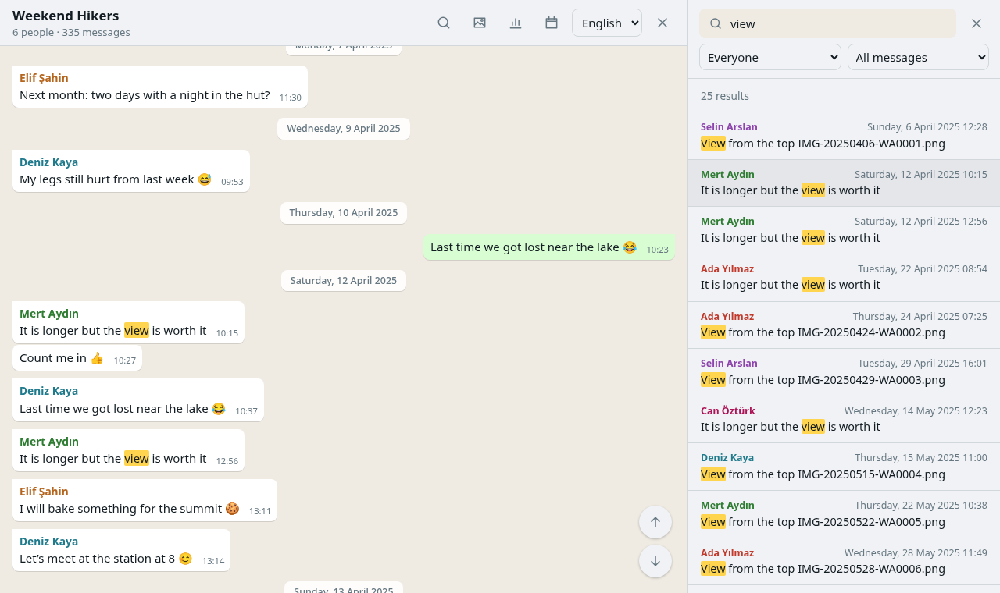
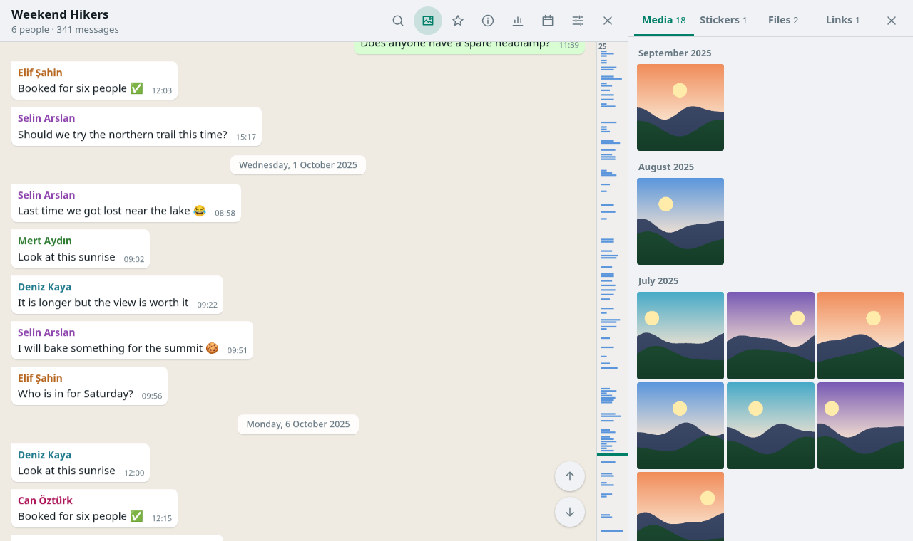
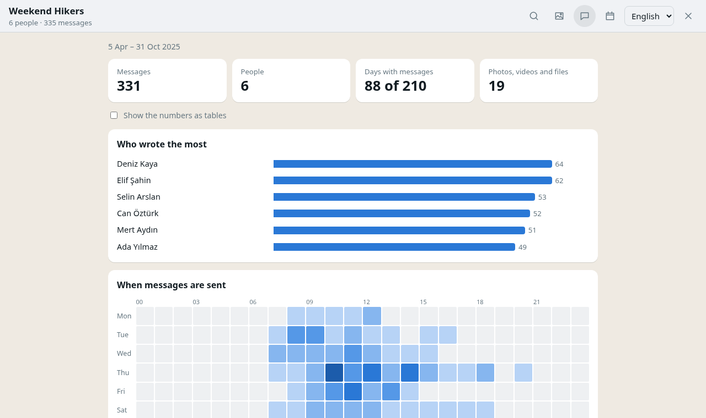

# chatledger

Open a WhatsApp or Telegram chat export on your own computer and read everything that happened in it.

chatledger runs on your machine and shows the chat in your browser. Your messages, photos and voice notes are never uploaded anywhere: the app makes no network requests at all, and its content security policy would block them if it tried.

[Türkçe](README.tr.md)



## What it does

- Opens the `.zip` or `.txt` that WhatsApp exports, or a folder of loose files. Android exports are fully supported; iPhone exports are experimental for now (see *Known limits*).
- Opens Telegram chats too, exported from Telegram Desktop as JSON or HTML, with their replies, forwarded messages, reactions and hidden spoiler text. This is experimental for now as well.
- Shows the chat the way you remember it, with photos, videos, stickers, voice messages, documents, polls and group events, and stays smooth on chats with hundreds of thousands of messages.
- Finds messages fast. Capitals and accents do not matter, so `ogretmen` finds `Öğretmen`. Put an exact phrase in quotes, or filter by person, media or links.
- Shows formatting the way WhatsApp does: *bold*, _italic_, ~strikethrough~, `code`, @mentions and large emoji.
- Jumps to any date, to the first or last message, or along a timeline beside the chat. It opens where you stopped reading, and every message has a link of its own.
- Lets you star messages, copy them, and export or import your stars.
- Joins several exports of the same chat into one timeline. WhatsApp only exports the most recent messages, so long chats often come in pieces; messages that appear in more than one are kept once, in their fullest form.
- Prints a whole chat, a date range or the starred messages, or saves them as a PDF.
- Plays voice messages at 1×, 1.5× or 2× speed with their waveform, shows shared contact cards, and previews PDF and Word documents.
- Shows the group's history: who created it, how its name changed, who is still in it, and what was said on this day in earlier years.
- Collects every photo and video, file and link of the chat in one place, with a full-screen viewer.
- Counts who wrote the most and when the chat is busiest. Also shows messages per month, favourite emoji, the longest silence and more.
- Remembers chats you open, so they are still there after a restart. You can turn this off, and you can remove any saved chat.
- Speaks English, German, Spanish, French, Italian, Portuguese and Turkish, and reads exports from phones set to any of them. Group events are written in the language you read in, whatever language the phone used.
- Has a light and a dark theme, three text sizes and keyboard shortcuts (press `?`).

| Gallery | Statistics |
| --- | --- |
|  |  |

The pictures show a made-up chat that comes with the tests.

## Getting started

### 1. Export the chat

- **Android:** open the chat, tap ⋮ › More › Export chat, and choose **Include media**.
- **iPhone:** open the chat, tap its name at the top, then **Export Chat › Attach Media**.

Save the file to your computer.

**Telegram:** chats can only be exported from [Telegram Desktop](https://desktop.telegram.org). Open the chat, click ⋮ › **Export chat history**, choose the media you want and either format. Telegram makes a folder; open that folder in chatledger, or zip it and open the zip.

### 2. Download chatledger

Pick the file for your computer on the releases page. Nothing needs to be installed.

- **Windows:** `chatledger-x.y.z-windows-x64.zip`
- **Linux:** `chatledger-x.y.z-linux-x64.zip`

Unzip it anywhere you like.

### 3. Start it

Double-click `chatledger.exe` on Windows, or `chatledger` on Linux. Your browser opens at `http://127.0.0.1:5170`.

- Windows may say it protected your computer, because the program is not signed with a paid certificate. Choose **More info › Run anyway**.
- On Linux, if double-clicking opens the file in a text editor, right-click it and choose *Run*, or run `./chatledger` in a terminal.

chatledger runs in the background while one of its tabs is open and stops by itself a few minutes after you close the last one.

#### If you already have Node.js

With [Node.js](https://nodejs.org) 22 or newer, the much smaller `chatledger-x.y.z.zip` works on any system. Unzip it, then double-click `chatledger.cmd` on Windows or run `./chatledger.sh` on Linux. Keep the window that appears open while you use chatledger; closing it stops the app.

chatledger is tested in current versions of Firefox and of Chrome, Edge and other browsers built on Chromium.

## Known limits

- **iPhone exports are experimental.** chatledger follows the iPhone export format, but it has not yet been tried on many real iPhone exports. If one does not open or looks wrong, please report it (see below).
- Exports from phones set to German, Spanish, French, Italian or Portuguese follow WhatsApp's wording in those languages but have not yet been checked against many real exports. If a group event shows up in the phone's language instead of yours, or an attachment is not recognised, please report the line (with the names changed).
- Group events from phones set to any other language are shown as WhatsApp wrote them, without translation. Messages, dates and media work in every language.
- **Telegram support is experimental.** It follows the format Telegram Desktop writes but has not yet been tried on many real exports. In HTML exports, service messages such as "Ada invited Bora" are read from Telegram's English wording; ones it does not know are shown as written. Animated stickers show their still picture. An export of a whole account is not opened: export one chat at a time.

## Where your chats are kept

When remembering is on, an opened export is copied into your browser's private storage for the chatledger address. It stays on this computer, in this browser. To remove a chat, use **Remove** in the saved list. Clearing the browser's site data for `127.0.0.1:5170` removes all of them.

Turn off **Remember chats I open on this computer** on the start screen if you share the computer with others, or choose **Protect saved chats with a password**. Saved chats are then encrypted, names included, and nobody can read them without the password. Keep it safe: if it is lost, the saved chats can only be removed, never opened.

## Running from source

```sh
git clone https://github.com/abel0x/chatledger.git
cd chatledger
npm install
npm start
```

| Command | What it does |
| --- | --- |
| `npm start` | Builds when needed and opens the app at `http://127.0.0.1:5170` |
| `npm run dev` | Development server with live reload |
| `npm test` | Runs the tests |
| `npm run test:e2e` | Runs the browser tests in Chromium and Firefox |
| `npm run screenshots` | Takes the README pictures from the demo chat |
| `npm run check` | Type-checks the code |
| `npm run release` | Builds the zip that runs with Node.js, and the single program for this system (needs Node.js 26) |

The code is in three layers: `src/core` reads exports and knows nothing about the screen, `src/loader` opens archives in a worker, and `src/ui` is the Svelte interface. Tests use made-up chats only; `tests/e2e/demo.ts` builds the demo export the browser tests and screenshots use. If you keep real exports in a `coldstorage/` folder, a few extra tests run against them on your machine. That folder is ignored by git.

## Reporting a problem

For security problems, follow [SECURITY.md](SECURITY.md) instead and report them privately.

If an export does not open or something looks wrong, please open an issue and describe it. Include your phone's language and whether it is Android or iPhone. Do not attach your chat. If a line is read wrongly, change the names and text in it before sharing.

## Not affiliated with WhatsApp or Telegram

chatledger is an independent project. It is not made, endorsed or supported by WhatsApp, Meta or Telegram. WhatsApp and Telegram are trademarks of their owners.

## License

Copyright © 2026 abel0x

chatledger is free software: you can redistribute it and/or modify it under the terms of the GNU General Public License as published by the Free Software Foundation, either version 3 of the License, or (at your option) any later version. See [LICENSE](LICENSE).
