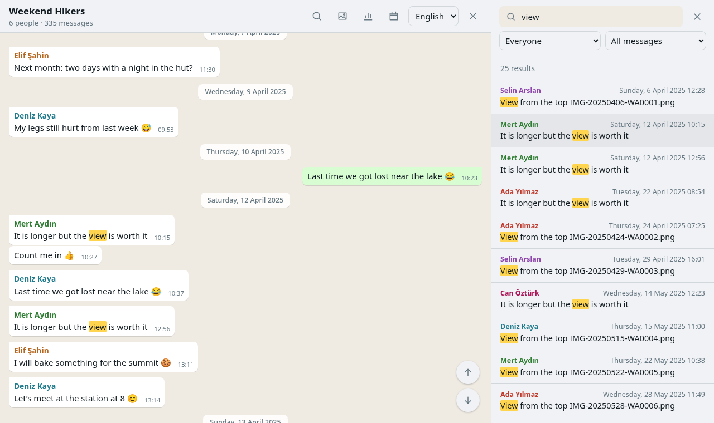
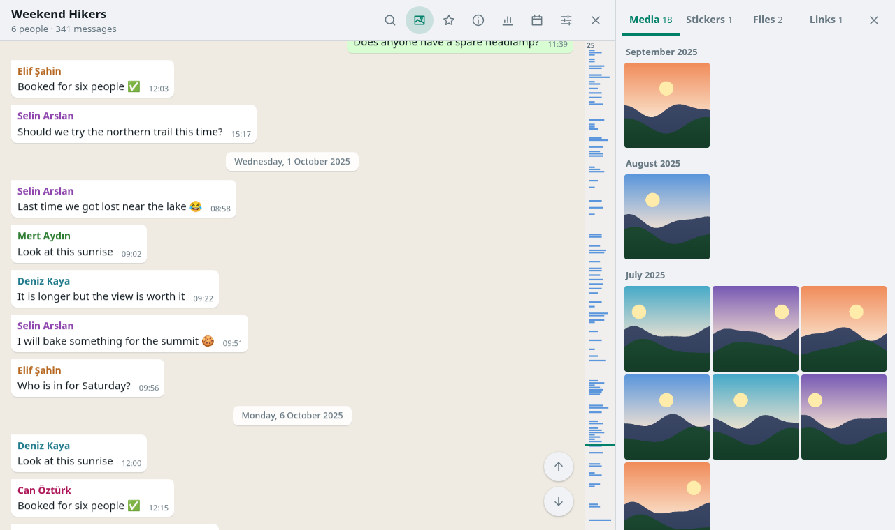
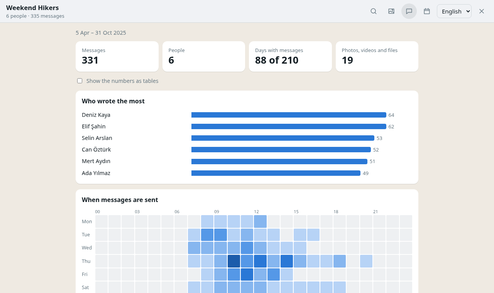

# chatledger

Bir WhatsApp sohbet dökümünü kendi bilgisayarınızda açın ve o sohbette olan her şeyi okuyun.

chatledger sizin bilgisayarınızda çalışır ve sohbeti tarayıcınızda gösterir. Mesajlarınız, fotoğraflarınız ve sesli mesajlarınız hiçbir yere yüklenmez. Uygulama hiçbir ağ isteği yapmaz; yapmaya kalkarsa içerik güvenlik politikası bunu engeller.

[English](README.md)



## Neler yapar

- WhatsApp'ın dışa aktardığı `.zip` veya `.txt` dosyasını ya da dosyaların bulunduğu bir klasörü açar. Android dökümleri tam olarak desteklenir; iPhone dökümleri şimdilik deneyseldir (bkz. *Bilinen sınırlar*).
- Sohbeti hatırladığınız gibi gösterir: fotoğraflar, videolar, çıkartmalar, sesli mesajlar, belgeler, anketler ve grup olayları. Yüz binlerce mesajlık sohbetlerde de akıcı kalır.
- Mesajları hızlı bulur. Büyük/küçük harf ve Türkçe karakterler fark etmez, `ogretmen` yazınca `Öğretmen` de bulunur. Tam bir ifadeyi tırnak içinde arayabilir, kişiye, medyaya ya da bağlantılara göre süzebilirsiniz.
- İstediğiniz tarihe ya da doğrudan ilk veya son mesaja götürür.
- Sohbetteki bütün fotoğraf ve videoları, dosyaları ve bağlantıları tek yerde toplar; fotoğraflar tam ekran açılır.
- En çok kimin yazdığını ve sohbetin en hareketli olduğu saatleri sayar. Aylara göre mesajları, sevilen emojileri, en uzun sessizliği ve daha fazlasını gösterir.
- Açtığınız sohbetleri hatırlar, yeniden başlattığınızda da yerinde olurlar. Bunu kapatabilir, kayıtlı herhangi bir sohbeti kaldırabilirsiniz.
- Arayüzü İngilizce ve Türkçedir. İki dilde ayarlanmış telefonların dökümlerini de okur.

| Galeri | İstatistikler |
| --- | --- |
|  |  |

Görsellerdeki sohbet, testlerle birlikte gelen uydurma bir sohbettir.

## Başlarken

### 1. Sohbeti dışa aktarın

- **Android:** sohbeti açın, ⋮ › Diğer › Sohbeti dışa aktar'a dokunun ve **Medyayı dahil et**'i seçin.
- **iPhone:** sohbeti açın, üstteki ada dokunun, ardından **Sohbeti Dışa Aktar › Medyayı Ekle**'yi seçin.

Dosyayı bilgisayarınıza kaydedin.

### 2. Node.js kurun

chatledger için [Node.js](https://nodejs.org) 22 veya daha yenisi gerekir. İndirme sayfasında LTS sürümünü seçin ve varsayılan ayarlarla kurun.

### 3. chatledger'ı indirip başlatın

Sürümler sayfasından en son `chatledger-x.y.z.zip` dosyasını indirin ve istediğiniz bir yere çıkarın.

- **Windows:** `chatledger.cmd` dosyasına çift tıklayın.
- **Linux:** bir terminalde `./chatledger.sh` komutunu çalıştırın ya da dosyaya çift tıklayıp *Çalıştır*'ı seçin.

Tarayıcınız `http://127.0.0.1:5170` adresinde açılır. chatledger'ı kullandığınız sürece açılan küçük pencereyi açık tutun. Pencereyi kapatınca uygulama durur.

chatledger, Firefox'un ve Chrome, Edge gibi Chromium tabanlı tarayıcıların güncel sürümlerinde test edilmektedir.

## Bilinen sınırlar

- **iPhone dökümleri deneyseldir.** chatledger iPhone'un dışa aktarma biçimine göre yazıldı, ancak henüz pek çok gerçek iPhone dökümüyle denenmedi. Biri açılmazsa ya da yanlış görünürse lütfen bildirin (aşağıya bakın).
- İngilizce ve Türkçe dışındaki dillerde ayarlanmış telefonlardan gelen "ekledi", "ayrıldı" gibi grup olayları çevrilmeden, WhatsApp'ın yazdığı gibi gösterilir. Mesajlar, tarihler ve medya her dilde çalışır.

## Sohbetleriniz nerede saklanır

Hatırlama açıkken açtığınız döküm, tarayıcınızın chatledger adresine ait özel depolama alanına kopyalanır. Bu kopya yalnızca bu bilgisayarda, bu tarayıcıda kalır. Bir sohbeti kayıtlı listeden **Kaldır** ile silebilirsiniz. Tarayıcıda `127.0.0.1:5170` için site verilerini temizlemek hepsini siler.

Bilgisayarı başkalarıyla paylaşıyorsanız başlangıç ekranındaki **Açtığım sohbetleri bu bilgisayarda hatırla** seçeneğini kapatın.

## Kaynak koddan çalıştırma

```sh
git clone https://github.com/abel0x/chatledger.git
cd chatledger
npm install
npm start
```

| Komut | Ne yapar |
| --- | --- |
| `npm start` | Gerekirse derler ve uygulamayı `http://127.0.0.1:5170` adresinde açar |
| `npm run dev` | Değişiklikleri anında yansıtan geliştirme sunucusu |
| `npm test` | Testleri çalıştırır |
| `npm run test:e2e` | Tarayıcı testlerini Chromium ve Firefox'ta çalıştırır |
| `npm run screenshots` | README görsellerini demo sohbetten çeker |
| `npm run check` | Kodun tiplerini denetler |
| `npm run release` | npm veya kaynak kod olmadan çalışan bir zip hazırlar |

Kod üç katmandan oluşur. `src/core` dökümleri okur ve ekrandan habersizdir. `src/loader` arşivleri bir worker içinde açar. `src/ui` ise Svelte arayüzüdür. Testler yalnızca uydurma sohbetler kullanır; tarayıcı testlerinin ve ekran görüntülerinin kullandığı demo dökümü `tests/e2e/demo.ts` üretir. Gerçek dökümleri bir `coldstorage/` klasöründe tutarsanız, birkaç ek test sizin bilgisayarınızda onlarla da çalışır. Bu klasör git tarafından yok sayılır.

## Sorun bildirme

Bir döküm açılmıyorsa ya da bir şey yanlış görünüyorsa lütfen bir issue açıp anlatın. Telefonunuzun dilini ve Android mi iPhone mu olduğunu da yazın. Sohbetinizi eklemeyin. Yanlış okunan bir satır varsa, paylaşmadan önce içindeki adları ve metni değiştirin.

## WhatsApp ile bağlantısı yoktur

chatledger bağımsız bir projedir. WhatsApp ya da Meta tarafından yapılmamış, onaylanmamış ve desteklenmemektedir. WhatsApp, sahibine ait bir ticari markadır.

## Lisans

Telif hakkı © 2026 abel0x

chatledger özgür bir yazılımdır: Free Software Foundation tarafından yayımlanan GNU Genel Kamu Lisansı'nın 3. sürümü ya da (tercihinize göre) daha sonraki herhangi bir sürümü koşullarına uygun olarak yeniden dağıtabilir ve/veya değiştirebilirsiniz. Ayrıntılar için [LICENSE](LICENSE) dosyasına bakın.
